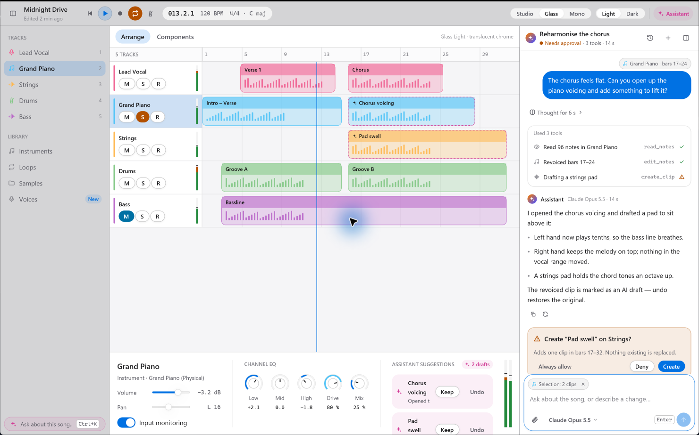

# Atelier

A design language and component kit for [gpui](https://crates.io/crates/gpui) creator tools with
built-in AI agents: theme tokens in three candidate directions (Glass, adopted; Studio and Mono
as alternatives), basic controls, creator controls (knobs, meters, transport), audio visualisations, 2-D and 3-D
plots, welcome-screen backdrops, and the agent side panel, transcript and composer. It ships as a Rust crate and as an agent Skill for Claude Code and Codex.



## Install

Atelier is used straight from this repository, pinned to a release tag:

```toml
[dependencies]
gpui = "=0.2.2"
atelier = { git = "https://github.com/uthree/design-language", tag = "v0.3.0" }
```

```rust
use atelier::prelude::*;   // theme, cx.theme(), cx.strings() and the everyday components
use atelier::agent::Composer; // specialised parts stay in their modules: agent, graph, viz, plot, …
```

- **Pin a tag.** Each tag `vX.Y.Z` matches the crate's version and a section of
  [CHANGELOG.md](CHANGELOG.md), which lists what to change and what workarounds to delete when
  you move up. `Cargo.lock` records the exact commit, so a build never moves on its own; to
  upgrade, change the tag and run `cargo update -p atelier`. A `rev = "<commit>"` works too, for
  a fix that is not in a release yet.
- **Same gpui.** Atelier pins gpui `=0.2.2`; depend on the same version, or use
  `atelier::gpui`, which is always the one Atelier was built with.
- **Features.** `gpu` (on by default) shades the liquid metal, the ambient backdrops and the 3-D
  plots with wgpu. An application that shows none of them, or wants a smaller build, can turn it
  off with `default-features = false`; those parts then draw on the CPU, exactly as they do on a
  machine without a GPU. `runtime-shaders` turns on gpui's `runtime_shaders`, so the app builds
  on a Mac with only the Command Line Tools installed.
- **Working on both at once.** Point Cargo at a local checkout without touching the
  dependency line, in the application's `.cargo/config.toml` or `Cargo.toml`:

  ```toml
  [patch."https://github.com/uthree/design-language"]
  atelier = { path = "../design-language" }
  ```

Atelier is not on crates.io: gpui itself has no stable release there yet, and a crate with a git
dependency cannot be published. An application that depends on Atelier from git cannot be
published to crates.io either, but builds, ships binaries and bundles as usual. Setting up the
theme, windows and fonts is in
[skills/atelier-gpui/references/adopting.md](skills/atelier-gpui/references/adopting.md).

Try the mock creator tool used to compare the candidates:

```bash
cargo run --example showcase -- --direction glass --appearance dark
```

More examples — a coding-agent app, a physical-model instrument view, an analyser, a node-based
workflow editor, a MATLAB-style plotting workbench with 3-D views, welcome screens over liquid
metal and ambient backdrops, two Auris Studio windows redrawn, a preferences window and a legend of which control
handles which concept — are in [doc/examples.md](doc/examples.md). Install the Skill: see
[doc/skill.md](doc/skill.md). The candidates are compared in
[doc/candidates.md](doc/candidates.md); app icons and logos, two-letter element marks such as
Auris Studio's **Au**, are set out in [doc/app-icons.md](doc/app-icons.md); the rules and API live in
[skills/atelier-gpui](skills/atelier-gpui/SKILL.md).

For a browser or a Tauri webview, [`web/`](web/README.md) carries the same themes, components and
ambient backdrops as CSS, a little JavaScript and WebGPU, with the tokens written from the Rust
theme.

## License

Apache-2.0
