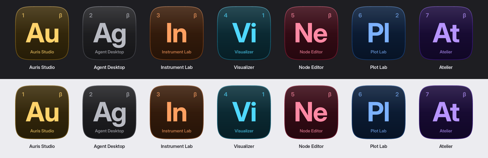
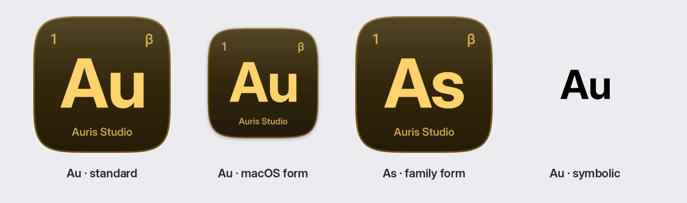
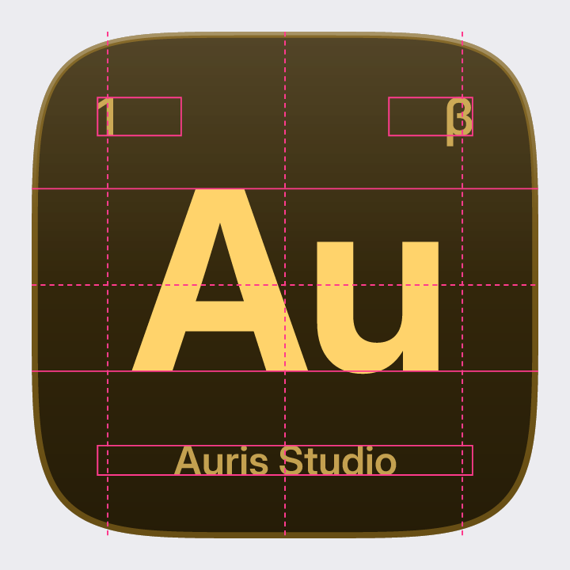
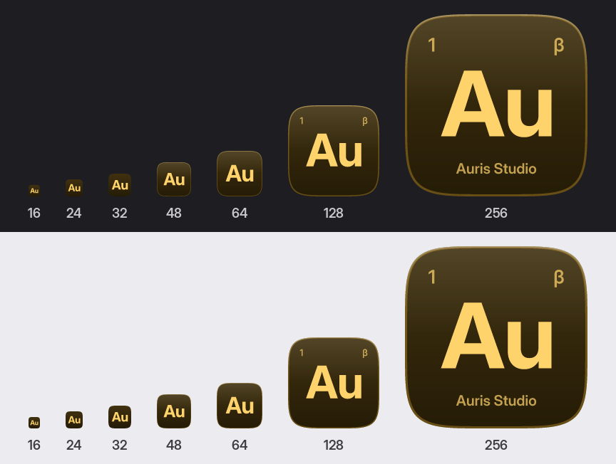

# App icons and logos

Every app built on Atelier is marked like an element in a periodic table: **two letters, a
capital and a lowercase, on a dark tile tinted in the app's element colour**, with the cell's
readings around them: the app's number top left, its edition (major version) top right and its
full name along the bottom. Auris Studio is **Au**. The marks of a suite read as one family, the way
Adobe's Ps, Ai and Pr do, and each still has its own symbol and hue.



The marks above are drawn by [`tools/app-icon/make_icons.py`](../tools/app-icon/make_icons.py)
from [`tools/app-icon/apps.toml`](../tools/app-icon/apps.toml). Only Auris Studio is a real app;
the others mark this repository's examples to show a suite side by side. Never draw a mark by
hand: add an entry and run the tool, so every icon shares one construction.

## The symbol

1. **Two letters: one capital, one lowercase.** `Au`, never `AU`, `au` or `A`. The pair is the
   logo; the app's full name is set beside it, not inside it.
2. **Take them from the app's distinctive word.** Drop words every app could carry: Studio, App,
   Pro, Lab, Desktop, Suite, Tool. Then:
   - one distinctive word: its first two letters (Auris → **Au**, Visualizer → **Vi**,
     Atelier → **At**);
   - two distinctive words: the two initials (Node Editor → **Ne**, as After Effects is Ae);
   - if that collides with another app of the suite, its first letter and its next consonant
     (Plot → **Pt**), and so on along the word.
3. **Unique in the suite.** Two apps never share a symbol, even in different colours.
4. **Legible at 16 px.** Reject pairs that blur together in Inter at small sizes: `Il`, `Ii`,
   `Ij`, `Ll`, `Rn` (reads as m), `Cl` (reads as d), `Vv`, `Ww`. Reject pairs that are words in a
   desktop interface: `Ok`, `No`, `Go`, `On`, `Up`.
5. **Real elements are welcome, not required.** Au is gold, so Auris Studio takes the gold
   element colour; Ag (Agent Desktop) is silver and takes graphite. Where the symbol names an
   element, pick the colour that agrees with it.

### Auris Studio: Au or As

**Au, gold, standard finish is the mark** (decided 2026-10-27). "Auris" is the distinctive word
and "Studio" is generic, so rule 2 gives Au, and it is gold, which ties the app to the
liquid-metal welcome screen.

**As** is the *family form*, kept for the day Auris becomes a family of products (Auris Studio,
Auris Voice, …): the family's initial and the product's initial, so siblings share their capital
(As, Av, …). Switch only when a second Auris product ships, and then switch every product at
once. Both are drawn below.



## The cell's readings

A periodic table prints more than the symbol: the atomic number, the atomic weight and the
element's name. The mark does the same, in the glyph colour at 72 %, Inter Display SemiBold:

| Where | Reading | Rule |
| --- | --- | --- |
| Top left | **Number** | The app's place in the suite's register, assigned in the order apps are created and never reused, the way an element keeps its atomic number. Auris Studio is **1**. |
| Top right | **Edition** | The major version alone, where a table puts the atomic weight: `1`, `2`, …, and `β` before 1.0. Auris Studio (0.13.0) shows **β**. Only a major release redraws the icon: a minor or patch release never does, because operating systems cache icons (the Dock, Finder, Explorer) and a number that changed every release would often show stale. |
| Bottom | **Name** | The app's full name as it is spelled everywhere else (Auris Studio), centred. |

The number and the edition are drawn from 128 px up, the name from 256 px up; below that they
would be noise. A system that shows the icon at 128 px (the macOS Dock, Windows' large icons)
therefore shows the corners but not the name, and the name appears where the icon is a picture:
Finder's preview, an About window, a store page.

## Construction

All measures are fractions of the tile's side *s* (1024 in the master).



| Part | Rule |
| --- | --- |
| Tile | Superellipse, exponent 5 (continuous corners, as Glass capsules and macOS draw them). Full bleed on Windows and Linux; on macOS an 824 tile on the 1024 canvas, lifted 10 and dropping a shadow (dy 10, blur 12, 32 % black). |
| Fill | Vertical gradient of the element hue: lightness 15.5 % at the top to 8.5 % at the bottom, saturation 62 → 70 % of the seed's. The tile is always dark, in light and dark appearances alike: it is an object on the desktop, not a surface of the theme. |
| Glass | A white sheen from the top (10 % to 0 at mid-height) and a rim 1.2 % *s* wide: the hue at 34 %, its upper edge lit white (28 % fading to 0 at a third), as `colors.highlight` lights a bezel. Both are dropped at 32 px and below. |
| Letters | Inter Display Bold, kerned, tracked −2 % of the em. Capital height 0.36 *s*, 0.44 *s* at 32 px and below. Centred horizontally on their ink; the cap height is centred vertically, then lifted 1 % *s*. The pair never spans more than 0.70 *s*; a wide pair is scaled down to fit. Letters align on the baseline and cap height, never on their bounding box, so a descender (the g of Ag) hangs below. |
| Number, edition | Inter Display SemiBold, capital height 0.075 *s*, on one baseline 0.205 *s* from the top; the number's ink starts 0.13 *s* from the left edge, the edition's ends 0.13 *s* from the right. |
| Name | Inter Display SemiBold, capital height 0.058 *s*, baseline 0.875 *s* from the top, centred. At most 0.74 *s* wide; a long name is scaled down to fit, never wrapped or abbreviated. |
| Colour | The glyph is the element's seed, lightened until it reaches **7:1** against the top of the tile, so the pair reads at 16 px. |

## Element colours

The hues come from the backdrop palettes (`BackdropPalette` in `src/backdrop.rs`) so the icon,
the welcome screen and the app's chrome share a family.

| Element | Seed | Glyph | Tile top → bottom | Contrast |
| --- | --- | --- | --- | --- |
| gold | `#ffd36b` | `#ffd36b` | `#40310f` → `#251c07` | 8.8:1 |
| orange | `#ff8a3d` | `#ffa061` | `#40220f` → `#251307` | 7.1:1 |
| crimson | `#e8455a` | `#f2929e` | `#3b1419` → `#220a0d` | 7.2:1 |
| rose | `#ff6f91` | `#ff89a4` | `#400f1b` → `#25070e` | 7.2:1 |
| violet | `#9b6bff` | `#b794ff` | `#1f0f40` → `#100725` | 7.2:1 |
| blue | `#3f8cff` | `#7cb1ff` | `#0f2340` → `#071325` | 7.2:1 |
| cyan | `#4fd8ff` | `#4fd8ff` | `#0f3540` → `#071e25` | 7.8:1 |
| seaglass | `#9ff7e0` | `#9ff7e0` | `#133c31` → `#09231c` | 9.8:1 |
| green | `#8fe08a` | `#8fe08a` | `#1b3619` → `#0e1e0d` | 8.3:1 |
| lime | `#e6f27a` | `#e6f27a` | `#383c13` → `#202209` | 9.6:1 |
| graphite | `#b8bac2` | `#b8bac2` | `#262629` → `#151517` | 7.8:1 |

- Give neighbouring apps of a suite hues at least two rows apart in this table.
- **Never the agent gradient.** The warm-to-cool three-stop sweep (`agent_gradient`) means "the
  AI" inside every Atelier app; an icon in it would say the whole app is the agent. An app whose
  core is an assistant still picks one element colour.
- A new element colour goes into `ELEMENTS` in the tool and this table, and must pass 7:1.

## Sizes



| Size | Detail |
| --- | --- |
| 256 px and up | Full: number, edition, name, sheen, rim. `icon.svg`. |
| 128 px | Number and edition, no name. `icon-corners.svg`. |
| 48–64 px | No readings. `icon-medium.svg`. |
| 16–32 px | No readings, sheen or rim; letters grow to 0.44 *s*. Drawn from `icon-small.svg`, not scaled down from the master. |
| Menu bar, tray, monochrome | `symbolic.svg`: the letters alone in black on 16 × 16, cap height 0.62. Use it as a macOS template image or a Linux `-symbolic` icon; the system tints it. |

## Finishes

- **Standard** (default): the glyph colour. Every icon file, every size. Auris Studio uses only
  this.
- **Metal** (optional, `metal = true` in `apps.toml`): the letters in a chrome ramp of the element's hue (bright sky, dark horizon at the
  middle, warm ground), after the liquid-metal backdrop. Only at 256 px and up, and only where the
  mark is a hero: an About window, the welcome card, a website. Never in the dock, the taskbar or
  a file list, where it would stand out from its siblings.

## Using the mark in the app

- Next to the app's name, the mark is the same height as the name's line box, spaced
  `spacing.sm` from it. Do not set the two letters as text in the UI; use the PNG or SVG.
- The welcome screen over a backdrop may show the mark on its card; the mark never sits on the
  metal or the scene itself, as the words don't.
- Do not recolour, outline, rotate, stretch, add a second line of letters, or put the mark on a
  tile of another colour.

## Making the files

```bash
pip install fonttools uharfbuzz resvg-py pillow   # and Inter Display (Bold, SemiBold)
python3 tools/app-icon/make_icons.py               # apps with ship = true, and these sheets
python3 tools/app-icon/make_icons.py --only node-editor --no-sheets
```

For each app it writes `assets/app-icons/<slug>/`:

| File | Use |
| --- | --- |
| `icon.svg`, `icon-corners.svg`, `icon-medium.svg`, `icon-small.svg` | The master (256 px and up) and its 128 px, 48–64 px and 16–32 px drawings (Linux `hicolor/scalable`, the web). |
| `icon-macos.svg`, `icon.icns` | macOS, on Apple's 824 grid (16 to 1024 px, @1x and @2x). |
| `icon.ico` | Windows: 16, 24, 32, 48, 64, 128 and 256 px, each from its own drawing. |
| `png/<size>.png` | 16 to 1024 px for Linux `hicolor/<size>x<size>/apps`, installers and stores. |
| `icon-metal.svg` | The metal finish, for hero uses only; written only with `metal = true`. |
| `symbolic.svg` | Menu bar, tray and monochrome contexts. |

To add an app: give it a slug, name, symbol, the next number, its current version and an
element in `apps.toml`, set `ship = true`, run the tool and commit the folder it writes. The tool refuses a symbol that is
not one capital and one lowercase letter, or an element colour it does not know.

## Review checklist

- [ ] Two letters, capital then lowercase, from the distinctive word; unique in the suite.
- [ ] Legible at 16 px on light and dark desktops (check `png/16.png` at 100 %).
- [ ] An element colour from the table, not the agent gradient, distinct from its neighbours.
- [ ] Number assigned from the register, not reused; `version` is the app's current release.
- [ ] Name spelled as everywhere else, fitting without abbreviation.
- [ ] Generated by the tool; no hand-edited SVGs. Redrawn at every major release (and at 1.0).
- [ ] Every platform file present: `.icns`, `.ico`, PNGs, scalable and symbolic SVGs.
