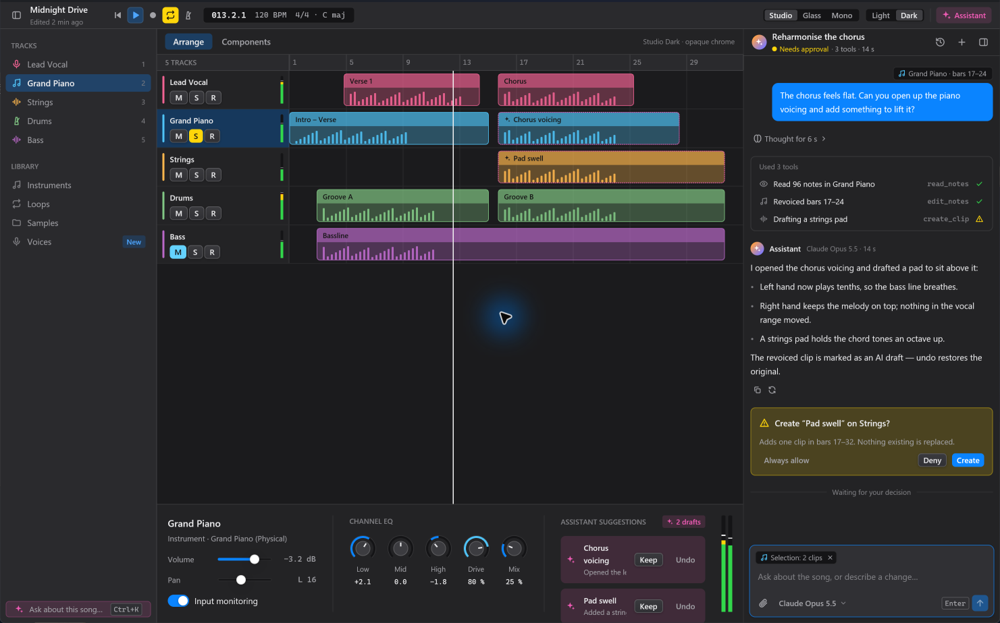
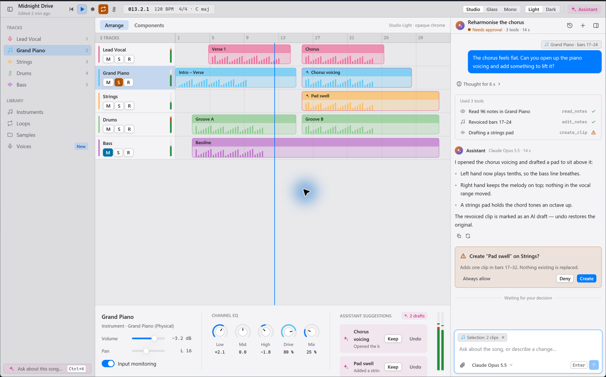
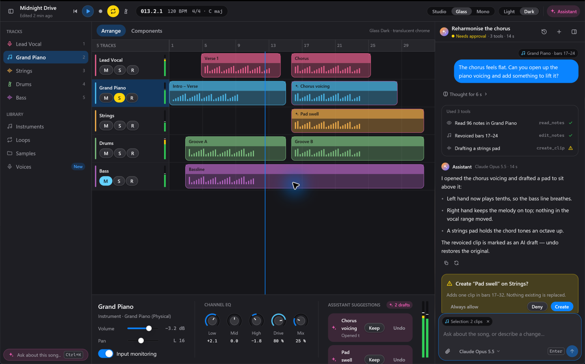
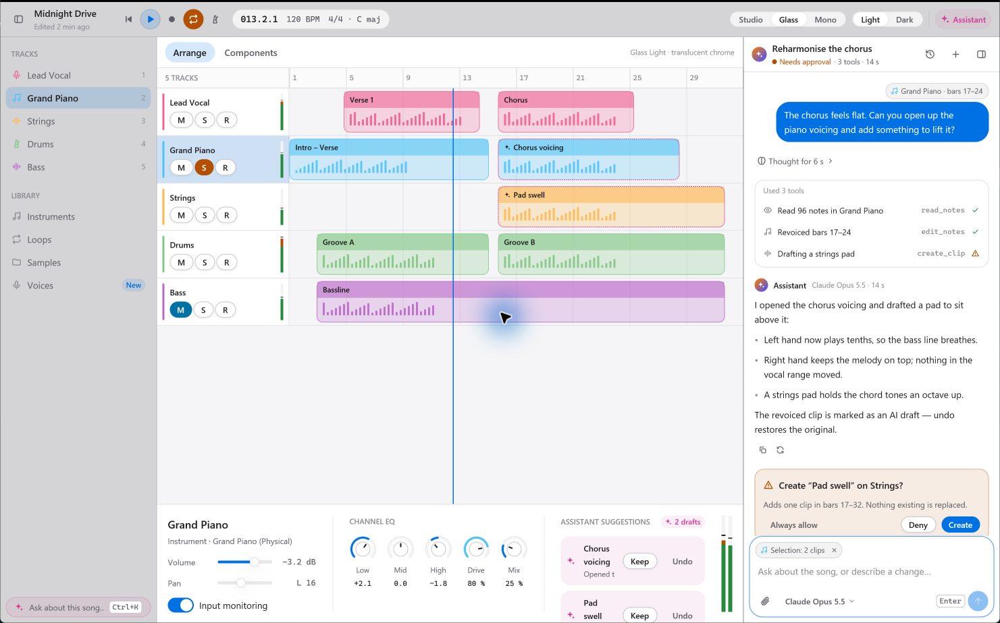
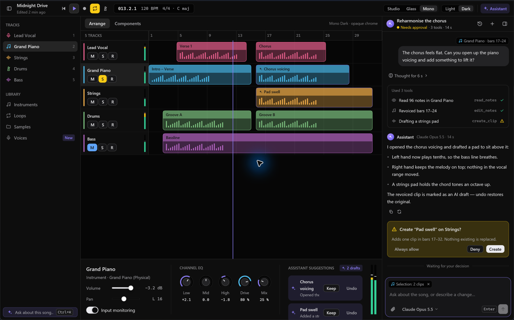
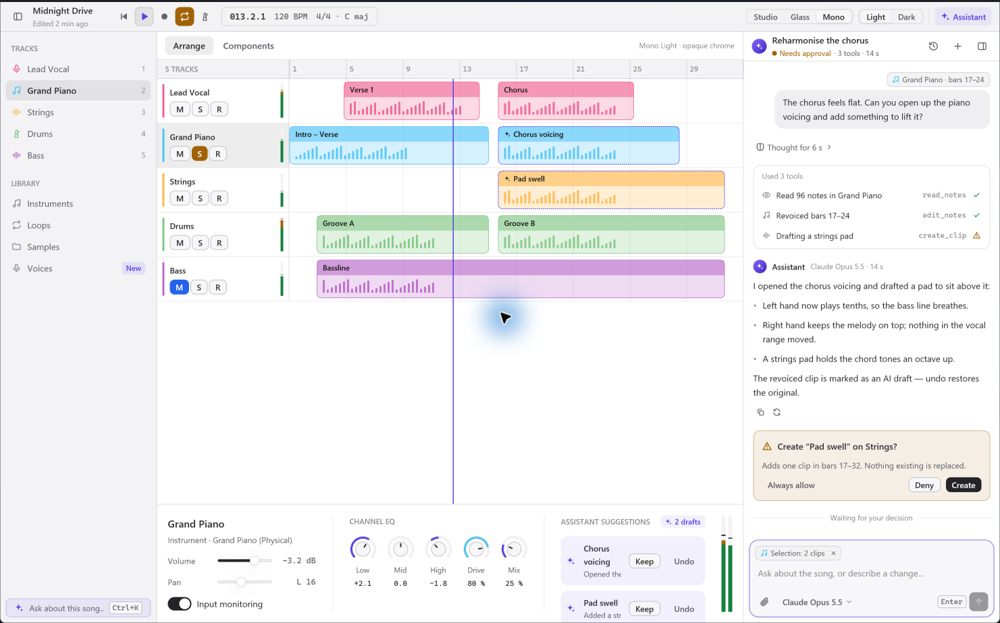

# Design candidates

**Glass is the adopted direction** and the crate default (`Direction::default()`). Studio and
Mono stay available as alternatives and as a check that components read tokens instead of
assuming one look.

One component set, three directions. Each fixes shape, density, chrome material, how the primary
action is filled and how the AI is coloured; colours are derived from a few seeds per direction
and checked for contrast in `src/theme.rs` tests.

Screenshots are of `examples/showcase.rs` (a mock arrangement view with the agent panel open),
captured on Windows at 150 % scale.

## Studio — after Logic Pro

Dense pro-tool chrome: graphite surfaces, 24 px controls, 5 px radii, top-lit bezel gradients on
raised buttons, system-blue accent, a white playhead. The agent uses Apple Intelligence's warm to
cool gradient. Best fit for Auris Studio's main window and other long-session timeline tools.

## Glass — after Liquid Glass (adopted)

Translucent chrome over a blurred window, 30 px capsule controls, large radii, roomier spacing.
Calmer and friendlier; costs density. Suits consumer-facing creator apps and secondary windows
(onboarding, voice setup, export).

The Glass screenshots below were captured before the translucency fix and before the custom
window frame, so they show opaque chrome under the system title bar.

## Mono — after zeron

Near-black (or white) monochrome, hairline alpha borders, solid foreground primary buttons and a
single violet reserved for the AI and focus. The person's messages are quiet grey cards, so
colour in the panel always means "the agent". Most editorial; strongest AI identity.

## Translucency

Glass asks the window for `WindowBackgroundAppearance::Blurred` through
`atelier::set_window_background`, which also keeps the macOS blur alive (below). The window root
is painted clear (`Theme::window_fill`), the title bar and sidebars carry the only tint
(`colors.chrome` at 42 % alpha dark, 50 % light), and content areas — the canvas, panels, the
agent transcript — stay opaque so text over them never depends on what is behind the window.

- **macOS:** confirmed working on macOS 27.0.1. gpui's own blur view comes up on
  `NSVisualEffectMaterial.selection`, which draws no backdrop under Liquid Glass and leaves the
  window plain transparent; `set_window_background` moves it to `.underWindowBackground`. Use
  that function instead of `Window::set_background_appearance`, both when the window opens and
  after every theme change — leaving the translucent material and coming back makes gpui build a
  fresh blur view.
- **Windows 10 1809+ / 11:** confirmed working. gpui 0.2.2 uses the undocumented
  `SetWindowCompositionAttribute` acrylic accent (not Mica). It needs *Settings → Personalization → Colors → Transparency
  effects* on; with it off, Windows draws the chrome solid.
- **Linux:** gpui 0.2.2 blurs only through KWin's `org_kde_kwin_blur`, so only KDE Plasma on
  Wayland gets the frosted backdrop. Everywhere else — GNOME, wlroots compositors, any X11
  desktop — a blurred window comes out plainly transparent, so `Theme::window_background` asks
  for an opaque window and `Theme::window_fill` paints the opaque background under the chrome.
  Checked under Weston (Wayland) and XWayland.

On Windows with transparency effects off, the tint alone is enough for legibility.

## Shared rules

The three follow the same rules ([skills/atelier-gpui/references/rules.md](../skills/atelier-gpui/references/rules.md)),
which adopt the GPUI Kit Design Guides: semantic tokens, the 2–32 px spacing grammar,
concentric radii, arrow cursors on controls, selection by fill, shadows only on floating layers.
