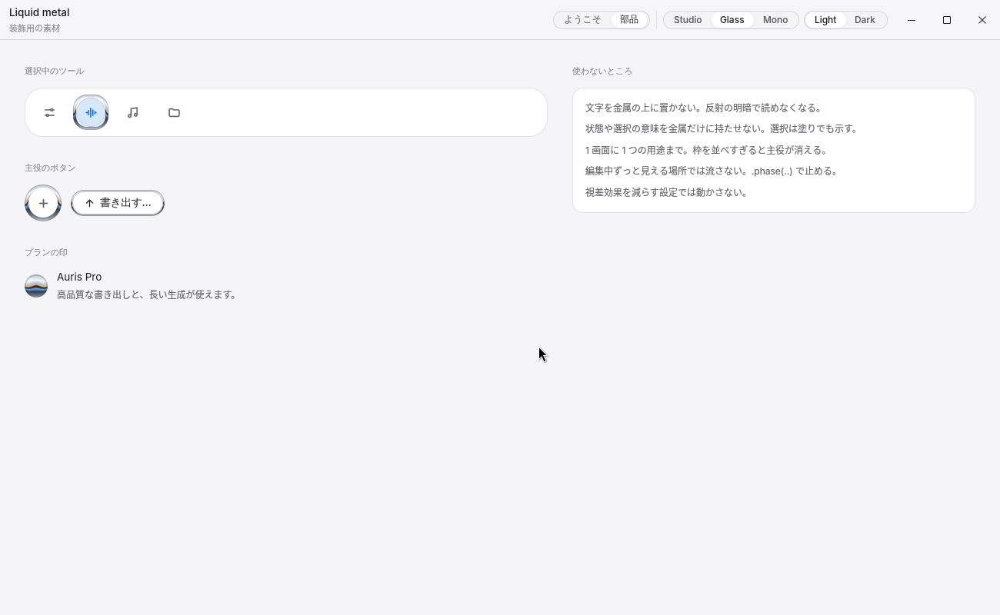
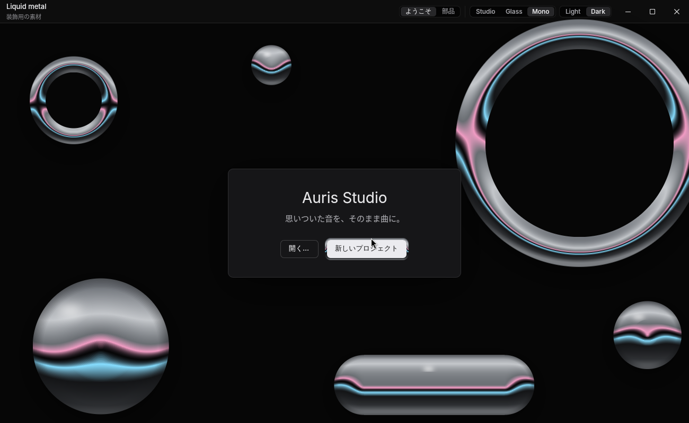

# Examples

Each example is a mock: it shows fixed or synthesised data and is wired to nothing. All of them
take `--direction glass|studio|mono`, `--appearance dark|light` and `--size WIDTHxHEIGHT`, and
carry the same switch in their title bar. Every example lays out from 900 × 600 (its minimum
window size) up to a large display: narrower windows drop the sidebar first, and spare height
goes to the plots. Screenshots are Glass dark, captured on Windows with `PrintWindow`, which does
not include the desktop blur behind translucent chrome.

## showcase — a DAW arrangement view

```bash
cargo run --example showcase
```

Track list, timeline with AI-drafted clips, inspector with knobs and meters, and the assistant
panel. The Components page lists every component, with live controls so transitions can be
watched, and a "Progress and loading" section.

## agent_desktop — a coding-agent app

```bash
cargo run --example agent_desktop
```

Sessions with live status on the left, the conversation in the middle (reasoning, grouped tool
calls, command output, a diff, the task plan, an approval), and the changes it made on the right.


## instrument_lab — a physical-model instrument

```bash
cargo run --example instrument_lab
```

Auris Studio's physical-instrument view: four voices' string motion with excitation points and
fading traces, the partials the bow position leaves in, the body's resonance curve and a drum
head's displacement, with exciter, string and body parameters and an agent fitting the model to
a reference. The motion is a sum of string modes computed per frame.


## visualizer — a master-bus analyser

```bash
cargo run --example visualizer
```

Spectrum with peak hold, R128 loudness readouts and meters, spectrogram, goniometer with phase
correlation, and a two-channel oscilloscope, driven by a synthesised programme.


## node_editor — a node-based workflow editor

```bash
cargo run --example node_editor
```

A ComfyUI-style graph for generating a pad: model loader, prompts, sampler, decoder and outputs,
with the node library on the left and the selected node's inputs, parameters and the run queue on
the right. Nodes drag; wires are pulled from an output onto an input of the same type (inputs of
another type step back while a wire is held), and pulling a connected input picks its wire up
again. Empty space or the scroll wheel pans. Run steps through the graph in dependency order,
shows each node's state and the sampler's progress, and reuses unchanged nodes on the next run.
Port and wire colours come from `colors.ports`, with the type also named on the port, in a tooltip
and in the legend. The loudness node was added by the assistant: it is drawn dashed in the agent
colour with Keep and Undo on the node, and the assistant panel holds the conversation.

## plot_lab — a numerical workbench

```bash
cargo run --example plot_lab
cargo run --example plot_lab -- --figure 3d
```

Plots for maths and physics in the manner of MATLAB, built on `atelier::plot`, with a
workspace of variables and the command history on the left. Everything runs on one simulation
clock, recomputed each frame; the title bar pauses it, restarts it and shows `t`. Figure 1 is
2-D: a damped oscillator at three damping ratios traced in real time, a histogram filling with
molecular speeds until it matches the Maxwell–Boltzmann density, three Van der Pol trajectories
winding onto their limit cycle, a square wave's Fourier coefficients (stems) and its partial sum
travelling (the term count is switchable), and a turning dipole's potential with equipotentials,
a colour bar and cuts through it. Figure 2 is 3-D: a square drum head with five modes ringing,
the Lorenz attractor with a comet tail running round it, and three point clusters drifting.
Drag any of them to turn all three; the inspector has the standard views, the shading
(faceted, smooth, mesh) and a turntable.
These two screenshots were captured on Linux under Xvfb.


## liquid_metal — liquid metal as ornament

```bash
cargo run --example liquid_metal
cargo run --example liquid_metal -- --screen parts
```

A welcome screen over `MetalBackdrop` (rings and drops drifting slowly), with the call to action
in a `MetalFrame`; and the parts: the selected tool of a palette, a round add button and an
export button in metal rings, a small `LiquidMetal` mark beside a plan, and the rules for where
metal does not go. gpui has no custom shaders, so each shape is a stack of concentric rounded
rectangles, one per device pixel of a ring, each painted in horizontal bands with two-stop
gradients that follow the theme's `metal` ramp exactly. Every edge comes from gpui's own
anti-aliased rounded-rectangle shader. Captured on Linux under Weston.






## auris_screens — two Auris Studio windows redrawn

```bash
cargo run --example auris_screens -- --screen chooser
cargo run --example auris_screens -- --screen compose
```

**Project chooser.** What changed from the current window: the two ways to start are choice
tiles with a description each, instead of an icon and a caption under one of them; the AI tile
carries the agent colour. Setup guidance moved to the sidebar, since it is help rather than a
way to start. The primary button names its result ("AIで作り始める…" when the AI tile is
chosen) and is the only primary in the window.


**AIで曲を作る.** The request and reply read as a conversation. Each take is a card with its
tempo and key, a waveform player rather than a bare slider, "この曲で続ける" and a quiet
"作り直す". The take still being made is tinted in the agent colour and shows its steps and
time left instead of an empty player. Stopping generation moved into the composer (Send becomes
Stop), so the footer keeps only navigation, the preference switch and the editor hand-off,
which explains why it is disabled.


