# Examples

Each example is a mock: it shows fixed or synthesised data and is wired to nothing. All of them
take `--direction glass|studio|mono`, `--appearance dark|light` and `--size WIDTHxHEIGHT`, and
carry the same switch in their title bar. Every example lays out from 900 × 600 (its minimum
window size) up to a large display: narrower windows drop the sidebar first, and spare height
goes to the plots. Screenshots are Glass dark, captured on Windows with `PrintWindow`, which does
not include the desktop blur behind translucent chrome.

## showcase — a DAW arrangement view

```bash
cargo run --example showcase
```

Track list, timeline with AI-drafted clips, inspector with knobs and meters, and the assistant
panel. The Components page lists every component, with live controls so transitions can be
watched, and a "Progress and loading" section.

## agent_desktop — a coding-agent app

```bash
cargo run --example agent_desktop
```

Sessions with live status on the left, the conversation in the middle (reasoning, grouped tool
calls, command output, a diff, the task plan, an approval), and the changes it made on the right.

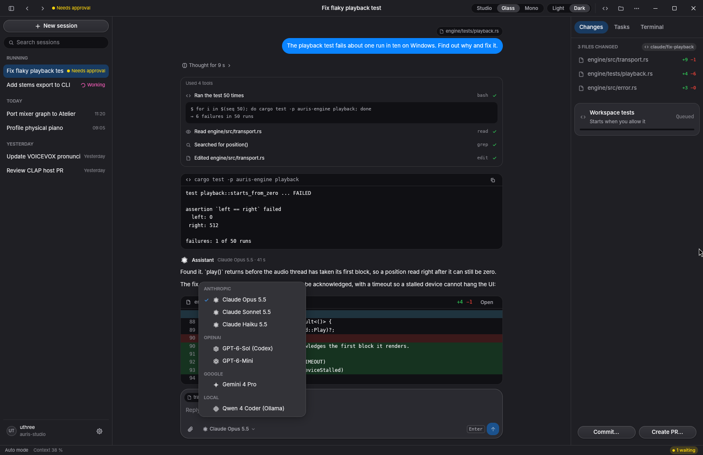

## instrument_lab — a physical-model instrument

```bash
cargo run --example instrument_lab
```

Auris Studio's physical-instrument view: four voices' string motion with excitation points and
fading traces, the partials the bow position leaves in, the body's resonance curve and a drum
head's displacement, with exciter, string and body parameters and an agent fitting the model to
a reference. The motion is a sum of string modes computed per frame.

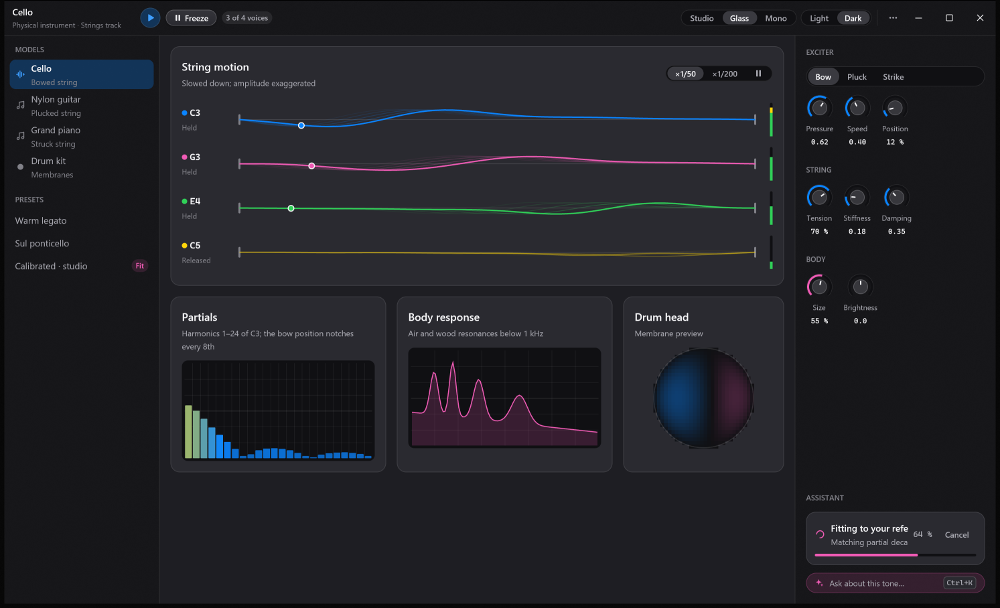

## visualizer — a master-bus analyser

```bash
cargo run --example visualizer
```

Spectrum with peak hold, R128 loudness readouts and meters, spectrogram, goniometer with phase
correlation, and a two-channel oscilloscope, driven by a synthesised programme.

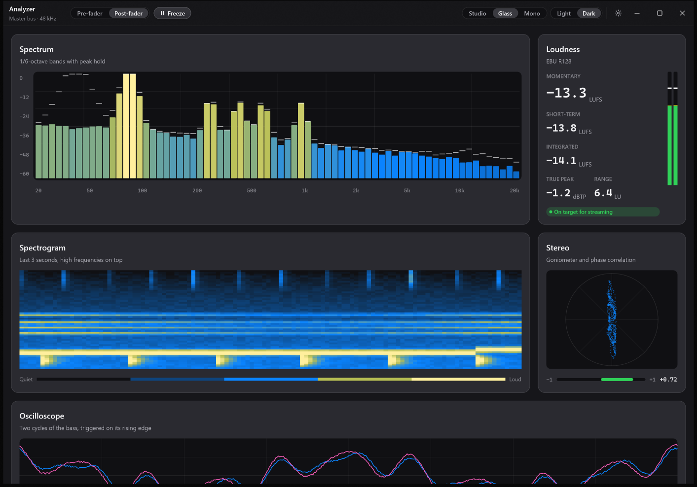

## node_editor — a node-based workflow editor

```bash
cargo run --example node_editor
```

A ComfyUI-style graph for generating a pad: model loader, prompts, sampler, decoder and outputs,
with the node library on the left and the selected node's inputs, parameters and the run queue on
the right. Nodes drag; wires are pulled from an output onto an input of the same type (inputs of
another type step back while a wire is held), and pulling a connected input picks its wire up
again. Empty space or the scroll wheel pans. Run steps through the graph in dependency order,
shows each node's state and the sampler's progress, and reuses unchanged nodes on the next run.
Port and wire colours come from `colors.ports`, with the type also named on the port, in a tooltip
and in the legend. The loudness node was added by the assistant: it is drawn dashed in the agent
colour with Keep and Undo on the node, and the assistant panel holds the conversation.

## plot_lab — a numerical workbench

```bash
cargo run --example plot_lab
cargo run --example plot_lab -- --figure 3d
```

Plots for maths and physics in the manner of MATLAB, built on `atelier::plot`, with a
workspace of variables and the command history on the left. Everything runs on one simulation
clock, recomputed each frame; the title bar pauses it, restarts it and shows `t`. Figure 1 is
2-D: a damped oscillator at three damping ratios traced in real time, a histogram filling with
molecular speeds until it matches the Maxwell–Boltzmann density, three Van der Pol trajectories
winding onto their limit cycle, a square wave's Fourier coefficients (stems) and its partial sum
travelling (the term count is switchable), and a turning dipole's potential with equipotentials,
a colour bar and cuts through it. Figure 2 is 3-D: a square drum head with five modes ringing,
the Lorenz attractor with a comet tail running round it and a swarm of 2,400 glowing particles
that leaves the comet's head as a tight ball every twelve seconds and spreads over the whole
attractor, and three point clusters drifting. With a GPU the 3-D plots are shaded with wgpu
(per-pixel lighting, depth, four samples a pixel); `ATELIER_GPU=off` shows the gpui-path
fallback.
Drag any of them to turn all three; the inspector has the standard views, the shading
(faceted, smooth, mesh) and a turntable.
These two screenshots were captured on Linux under Xvfb.

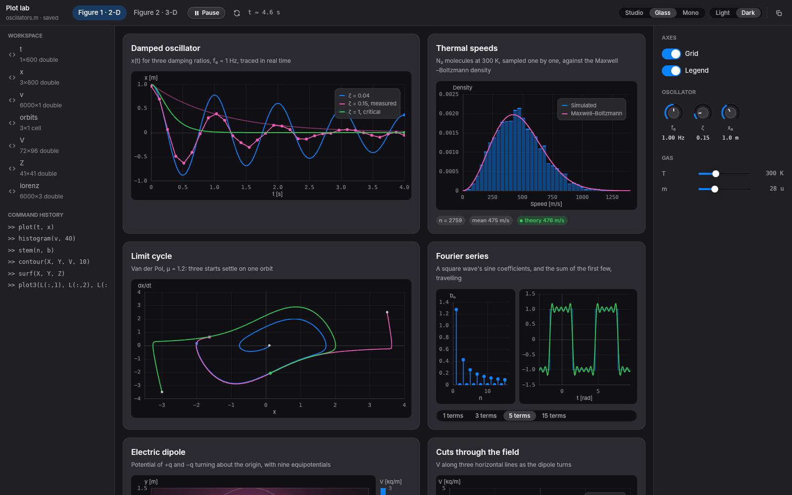

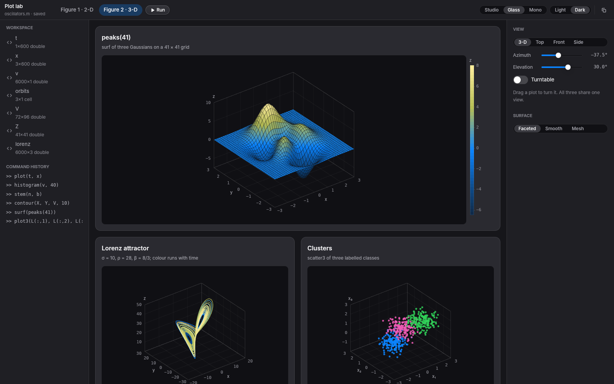

## ambient — a welcome screen over liquid metal or an ambient scene

```bash
cargo run --release --example ambient -- --backdrop metal|aurora|dunes|bloom|caustics|solar|galaxy|jellyfish|shoal|formation|garden
```

A welcome card over a backdrop: liquid metal or one of ten ambient scenes. A bar below the
card picks the backdrop and its palette (`--palette
theme|dusk|ocean|ember|meadow|graphite`): the theme's own colours or a preset, through
`.palette(BackdropPalette::…)` on either backdrop.

### Liquid metal

`MetalBackdrop`: pools of liquid chrome that merge, stretch and pinch off
as their drops drift. The liquid is a metaball field; its height gives each pixel a normal, and
the reflected view looks up a studio — the theme's `metal` ramp from sky to ground with its
coloured fringes at the horizon, a softbox, a strip light behind, and dark behind the metal, so
edges darken as polished metal does. gpui takes no custom shaders, so the backdrop shades each
frame with a WGSL shader on its own small wgpu device, off screen, and hands gpui the read-back
frame as an image: four samples a pixel, thin dispersion fringes, ripples running over the
surface and a second softbox. Without a hardware GPU it is, like the ambient scenes, one still
frame shaded on the CPU with a single sample and no extras, answering nothing. On the GPU the
liquid answers the pointer, which pushes drops aside and leaves ripples where it crosses the
metal, and the window, which leaves the liquid sloshing when it is moved or resized. Its drops
can be played with like the oil on a bowl of ramen: press on one and carry it, bring it up to
others and they fuse into one larger drop. A fused drop sheds one of its drops now and then,
more often when the pointer brushes across it, and tears apart if carried too fast;
double-click to part them all again. Metal is
kept to the welcome screen: on controls it made sizes uneven and said too much. Captured on Linux under Weston.

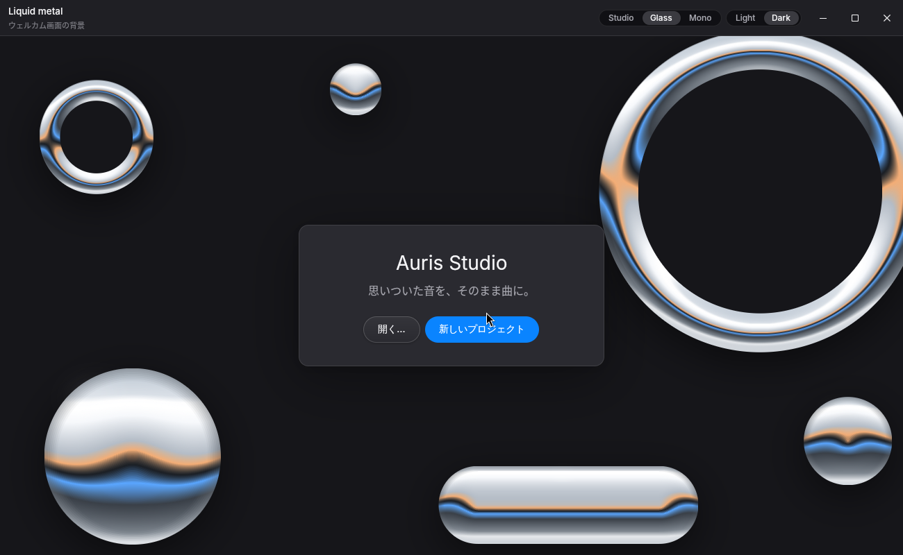

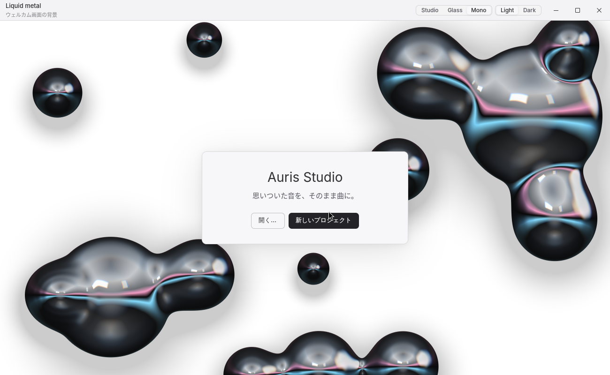

### Ambient scenes

`AmbientBackdrop` behind the same card: ten slow scenes in the manner of a desktop
wallpaper. **Aurora** hangs curtains of light in leaning rays
over a night sky with stars, mirrored in still water below. **Dunes** lays sheets of silk one in
front of another, each lit from above with a sheen on its slopes and a soft shadow on the one
behind. **Bloom** melts great clouds of colour into one another, stirred by slow eddies under a
frosted sheen. **Caustics** plays light through moving water over a deep floor, the colours
bending apart into thin fringes, with shafts of light from the surface. **Solar** sets a low sun
in wide breathing bands of colour, rays turning in its corona, soft clouds in its light and
three ridges standing in haze below, each rimmed with light. **Galaxy** turns a spiral galaxy
over a field of stars: a warm core, arms of young stars with lanes of dust and knots of glowing
gas, and now and then a shooting star. **Jellyfish** sends jellyfish drifting up through deep
water, their bells pulsing, lit from within, tentacles trailing, among sinking marine snow.
**Shoal** wheels two schools of small fish through sunlit shallows, each fish flicking its tail
and catching the light. **Formation** gathers points of light into one figure after another,
the edges of a cube, a rippling sheet, a knot and a double helix, turning in space over a floor
of faint lines, each point streaking a little along its path; the camera crosses from one side
of the window to the other with each new figure, so it is never hidden behind the content for long. **Garden** grows a row of plants
over the cycle: stems wander up and branch, leaves unfold and every tip blooms, then the petals
let go and drift down and the garden fades and grows again, swaying over a dusk of soft lights.
Solar, Galaxy, Formation and Garden are rich takes on the pixel scenes behind the boards of
[bevytris](https://github.com/uthree/bevytris); Formation's points and Garden's plants are laid
out on the CPU each frame and handed to their shaders, as Aurora's stars are. Every scene takes its
colours from the theme — background, agent gradient and accent — or from the palette picked
below the card, as light over the dark in a dark appearance and as washes of colour in a light
one.

Each is a WGSL shader on the crate's wgpu device, shaded off screen and read back like the metal.
Each answers the window: moving or resizing it leaves the scene behind for a moment, nearer
layers further, and it swings back. All but Dunes answer the pointer too. Bloom stirs the colour
round itself, Caustics gathers the light like a lens, Solar gathers ghosts of the sun along the
line to it, and Galaxy bends the light round itself like a great mass; these leave ripples as it
travels. Jellyfish glow brighter and shy away from it, fish dart away from it while the
school closes up behind (and a click scatters food that sinks slowly, which the nearest fish
break away from the school to snap up), Formation's points scatter round it, and Garden's plants lean away
from it. Aurora's curtains stay still, but its brighter stars wake as the
pointer passes and join into a constellation round it that fades behind it; press on a star
and let go over another to draw a line between them that stays (draw it again to take it
away), press on the open sky to send a shooting star, and double-click to wipe the lines away.
Without a hardware GPU the backdrop is one still frame shaded on the CPU, with no animation and
no response. Captured on Linux under Weston.

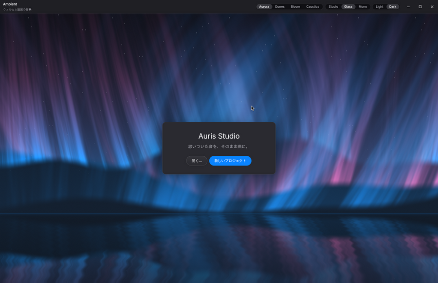

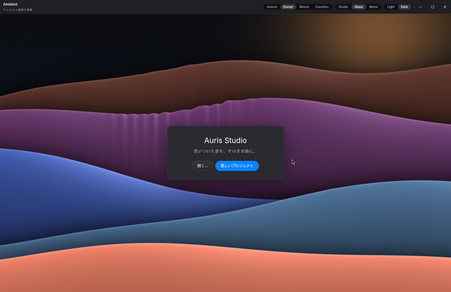

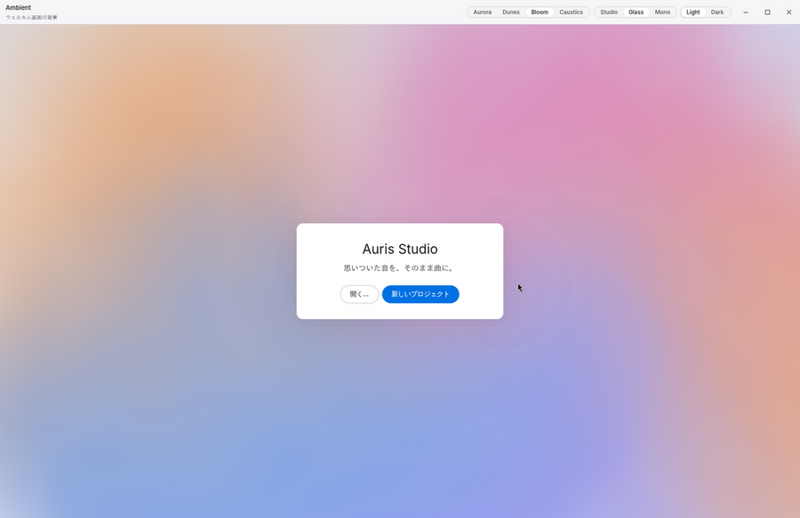

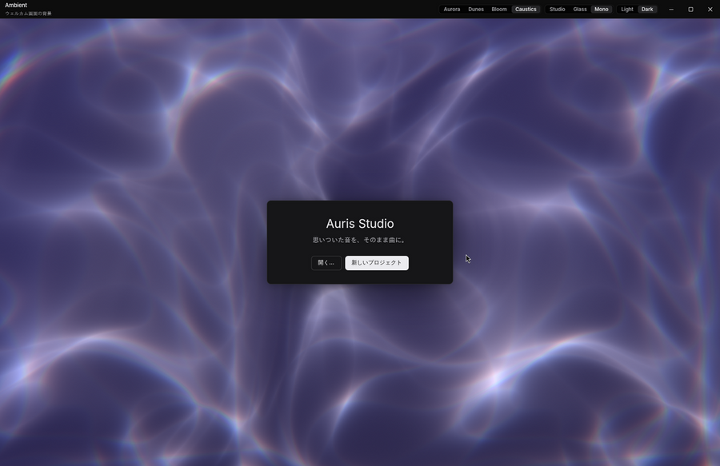

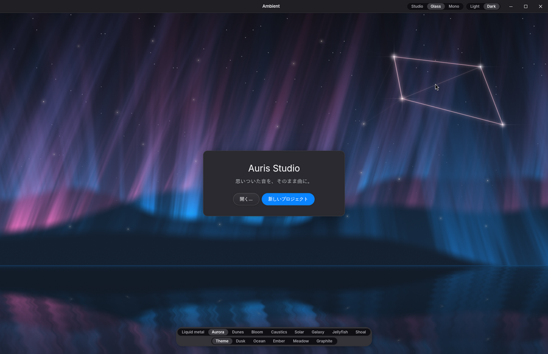

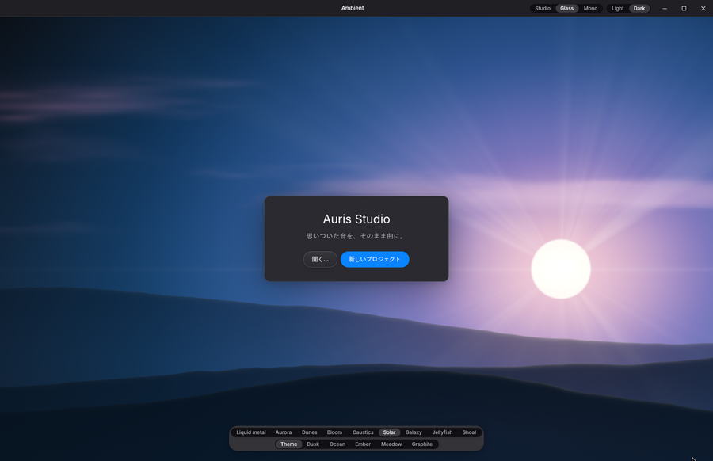

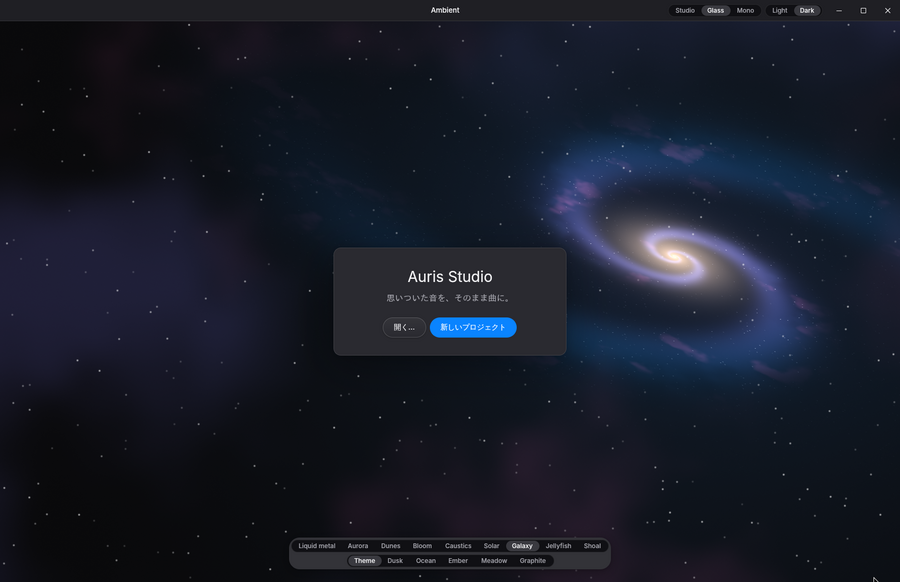

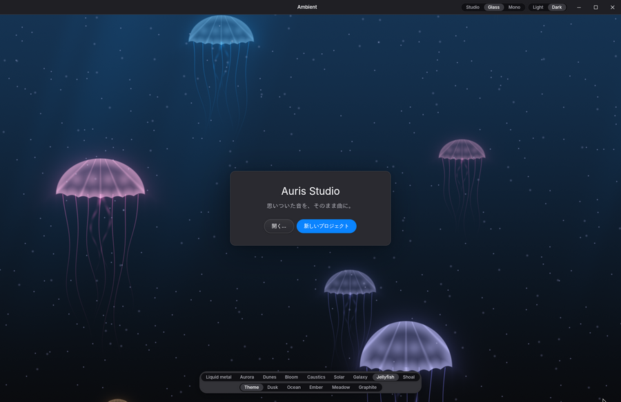

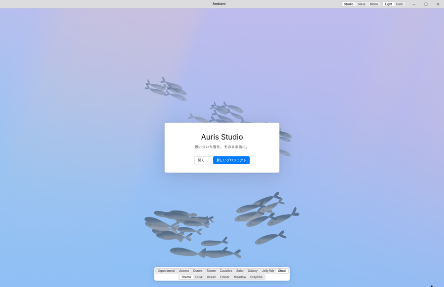

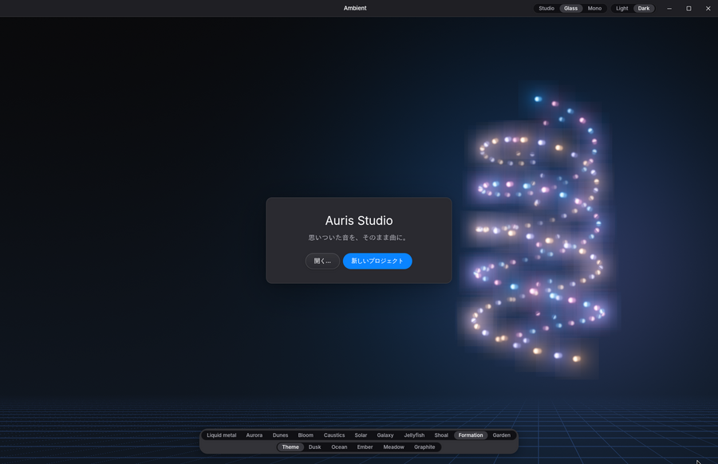

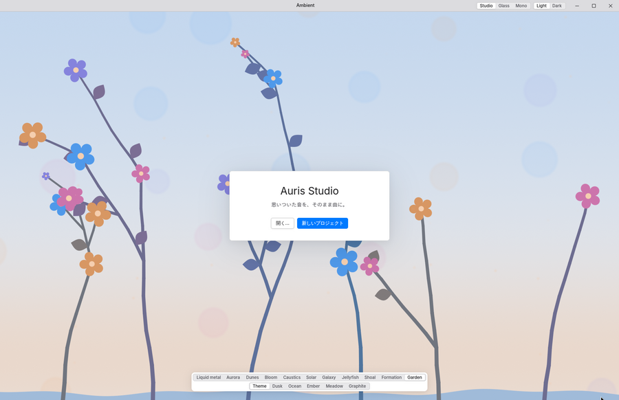

## auris_screens — two Auris Studio windows redrawn

```bash
cargo run --example auris_screens -- --screen chooser
cargo run --example auris_screens -- --screen compose
cargo run --example auris_screens -- --screen compose --slash   # the composer completing "/mo"
```

**Project chooser.** What changed from the current window: the two ways to start are choice
tiles with a description each, instead of an icon and a caption under one of them; the AI tile
carries the agent colour. Setup guidance moved to the sidebar, since it is help rather than a
way to start. The primary button names its result ("AIで作り始める…" when the AI tile is
chosen) and is the only primary in the window.

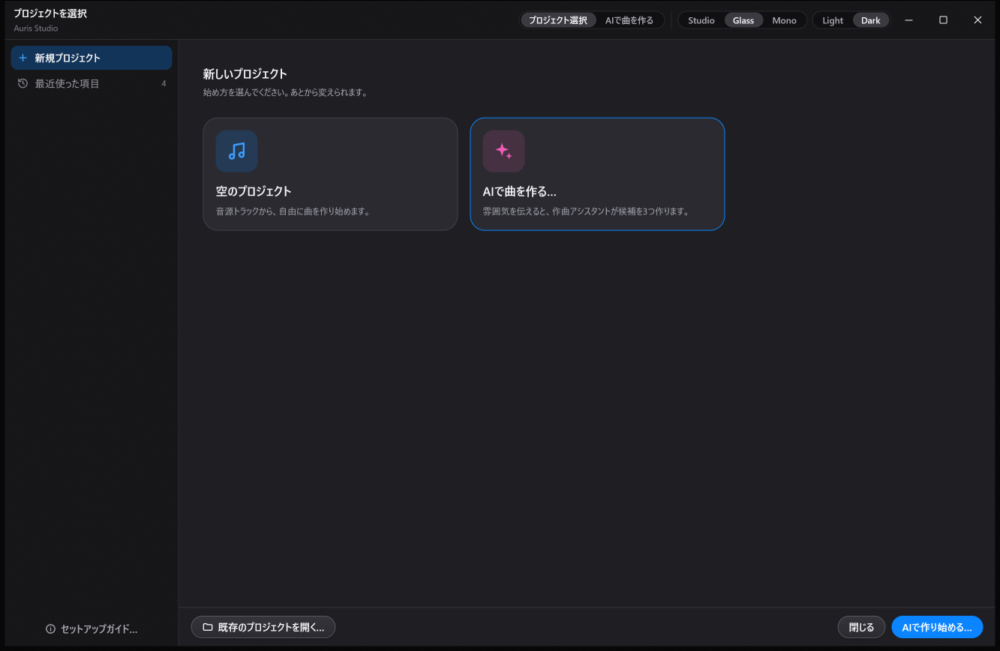

**AIで曲を作る.** The request and reply read as a conversation. Each take is a card with its
tempo and key, a waveform player rather than a bare slider, "この曲で続ける" and a quiet
"作り直す". The take still being made is tinted in the agent colour and shows its steps and
time left instead of an empty player. Stopping generation moved into the composer (Send becomes
Stop), so the footer keeps only navigation, the preference switch and the editor hand-off,
which explains why it is disabled. Only two voices speak, so the assistant's answer has no name
line (`AssistantMessage::anonymous()`); the model picker, the reasoning effort and fast mode sit
in the composer's own control row. Both messages carry a Copy button (`CopyButton`) and the
person's text can be selected; each take's name was written by the assistant, so it wears the
agent's sparkle (`AgentLabel`) and its own Copy button, and its player seeks, sets the volume
and mutes, with the keyboard too. `--slash` opens the composer's `Completions` on `/mo`.

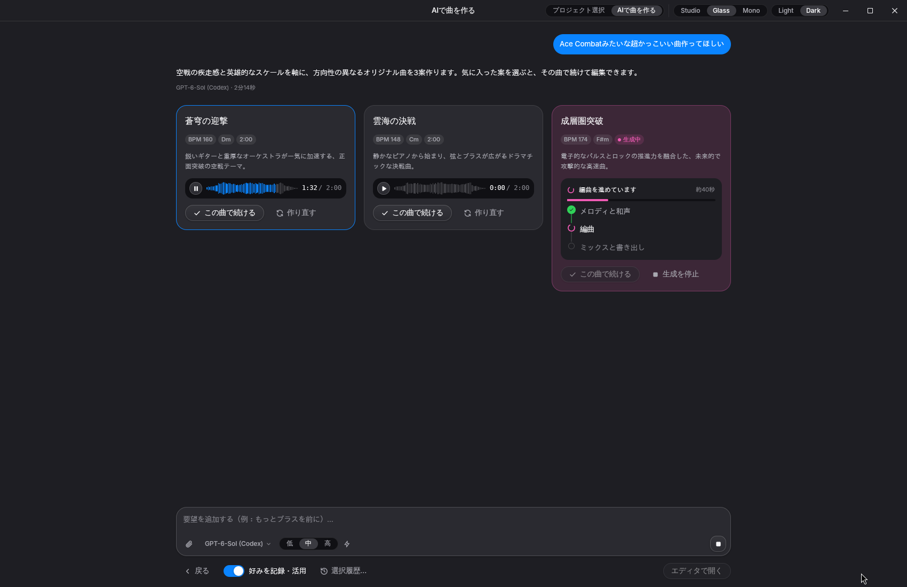

**The hand-off.** "AIで作り始める…" grows the AI tile's shape to fill the window while the compose
screen, already laid out at its final size, fades in over it (`Morph`; captured mid-way on
Linux).

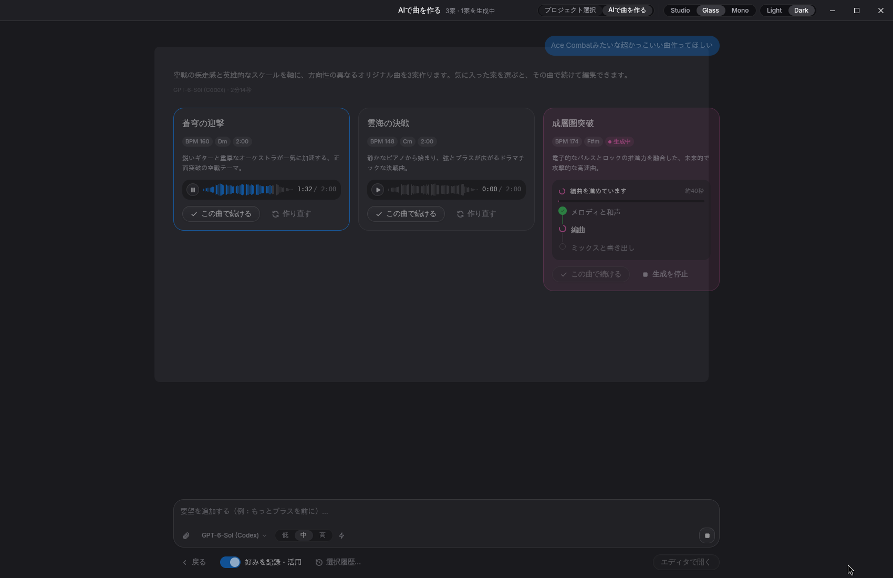

## preferences — a settings window

```bash
cargo run --example preferences -- --page general|voice|assistant|keys
```

The shape Auris Studio's settings take: pages in a sidebar that scrolls, with search first, two
lines of description per page and the setup guide last; each page a header and groups of
labelled fields in a readable column (`density.form_width`), labels above fields and beside
switches; the page's actions at its foot with Save at the trailing end; and a status bar that
reports what the last action did. Every control is reached with Tab; in the first picture the
outline sits on the "クラウド" segment after tabbing to it. Captured on Linux.

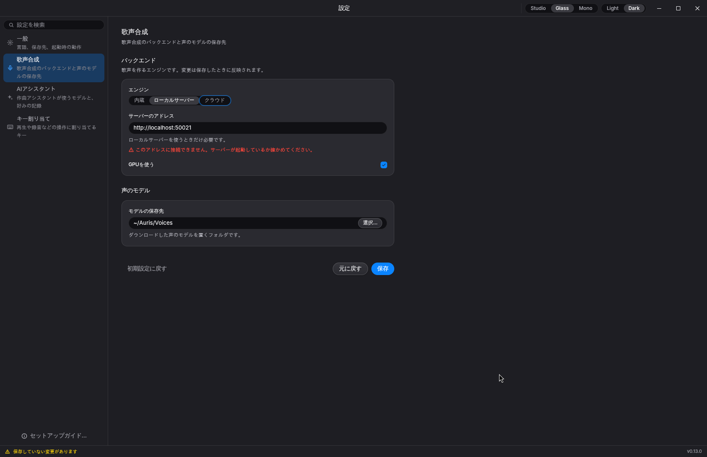

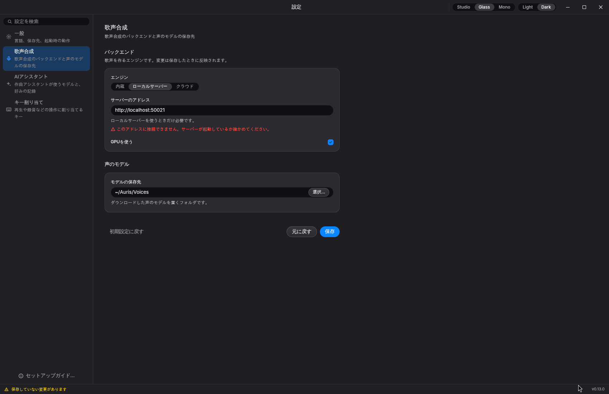
