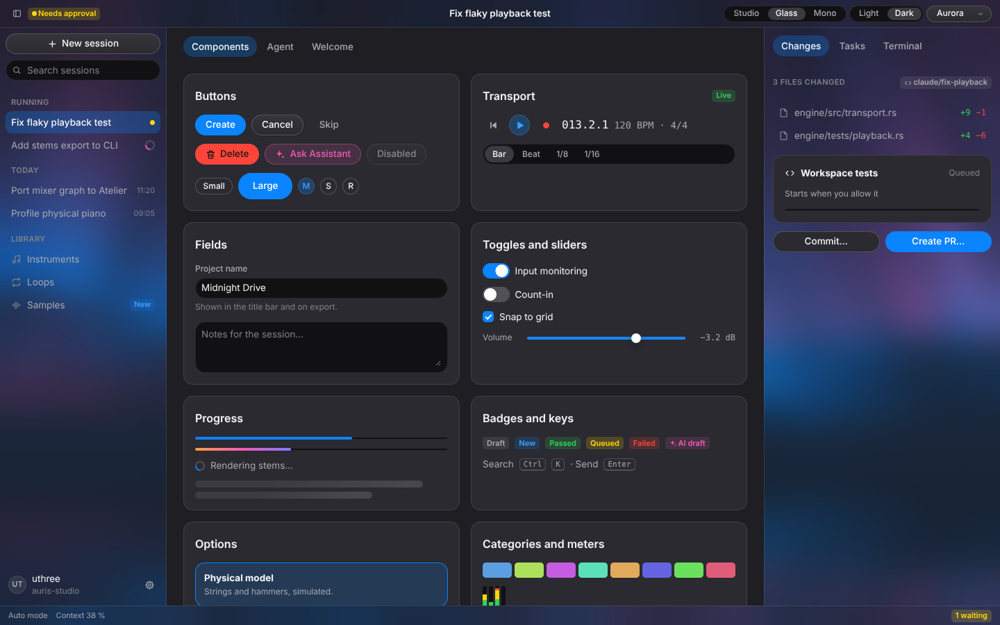

# Atelier for the web

The Atelier design language for pages in a browser or a [Tauri](https://tauri.app) webview: the
same six themes, the same components and the same ambient backdrops as the gpui kit, drawn with
CSS and WebGPU. It aims for the same style, not the same pixels.



No framework and no build step: one stylesheet and two small ES modules. Use them from plain
HTML, React, Svelte or anything else that renders markup.

```
web/
  showcase.html           every component, the agent surfaces and the backdrops
  atelier/
    atelier.css           the components
    atelier.js            themes, icons, and the behaviour of segmented controls, tabs, sliders
    ambient.js            the ambient backdrops on WebGPU
    generated/            written from the Rust crate; do not edit
      tokens.css          the six themes as CSS custom properties
      ambient.js          the backdrops' WGSL shaders, parameter layout and palettes
      icons.js            the icons as inline SVG
```

Try it with any static server from this directory, for example
`python3 -m http.server --directory web` and then <http://localhost:8000/showcase.html>.
`?theme=studio-light`, `?view=agent`, `?scene=Galaxy` and `?still=0.2` pick what it shows.

## Themes

Pick a theme with `data-theme` on `<html>` (or on any element, for a region in another theme):

```html
<html data-theme="studio-dark">
```

The ids are `studio-light`, `studio-dark`, `glass-light`, `glass-dark` (the default), `mono-light`
and `mono-dark`. From script, `setTheme({ direction: "mono" })` keeps the appearance and changes
the direction, and `followSystemAppearance()` follows the system's light or dark setting.

Every value is a token: `var(--at-accent)`, `var(--at-radius-md)`, `var(--at-control-md)`,
`var(--at-space-lg)`, `var(--at-shadow-medium)`. The names follow the Rust fields in kebab case
(`colors.text_muted` is `--at-text-muted`), so the design guide in
[`skills/atelier-gpui`](../skills/atelier-gpui/SKILL.md) applies unchanged. Write your own
components with tokens, never with colours.

### Where the tokens come from

`generated/tokens.css` is written by `atelier::web::stylesheet()` from `Theme::new`, so the rules
that make a palette coherent (contrast floors, accent fallbacks, how each button variant is
painted) live in one place. After a change to `src/theme.rs`, a button's paint, a shader or an
icon, write the files again:

```sh
ATELIER_BLESS_WEB=1 cargo test --lib web
```

`cargo test` fails while they are out of date. A Tauri app can also call
`atelier::web::theme_css(&theme)` itself to hand its webview a theme the six files don't cover,
such as `Theme::new(..).zoomed(1.25)`.

## Components

Class names follow the Rust components, and modifiers follow their builders:

| Rust | Web |
| --- | --- |
| `Button::new(..).primary()` / `.ghost()` / `.variant(Danger)` / `Agent` | `.at-button.at-button--primary` / `--ghost` / `--danger` / `--agent` |
| `.size(Small)` / `Large`, `Button::icon_only`, `.selected(true)` | `--sm` / `--lg`, `--icon`, `aria-pressed="true"` |
| `SegmentedControl`, `Tabs` | `.at-segmented`, `.at-tabs` with `<button>`s |
| `TextField`, `FormField` | `.at-field` around an `<input>`, `.at-form-field` |
| `Switch`, `Checkbox`, `Slider` | `.at-switch`, `.at-checkbox` around an `<input type=checkbox>`, `input.at-slider` |
| `Card`, `Popover`, `SectionHeader` | `.at-card`, `.at-popover`, `.at-section-header` |
| `ListItem`, `OptionCard`, `MenuItem` | `.at-list-item`, `.at-option-card`, `.at-menu-item` in `.at-menu` |
| `Badge`, `StatusDot`, `Kbd`, `Avatar` | `.at-badge--success` etc., `.at-status-dot`, `.at-kbd`, `.at-avatar` |
| `ProgressBar`, `Spinner`, `Skeleton`, `LevelMeter` | `.at-progress`, `.at-spinner`, `.at-skeleton`, `.at-meter` |
| `TitleBar`, `Toolbar`, `Sidebar`, `StatusBar` | `.at-title-bar`, `.at-toolbar`, `.at-sidebar`, `.at-status-bar`, each with `.at-chrome` |
| `Composer`, `ContextChip`, user and assistant messages | `.at-composer`, `.at-context-chip`, `.at-user-message`, `.at-assistant-message` |
| `Tooltip` | `data-tooltip="…"` on any element |

Icons are `<span data-icon="sparkles"></span>`; `hydrate()` from `atelier.js` draws them, and
wires segmented controls and tabs (click and arrow keys, an `atelier:select` event) and slider
fills. Call it again on markup a framework renders later. The provider marks are icons too:
`logo-anthropic`, `logo-openai`, `logo-google`, `logo-local`.

## Translucency

`.at-chrome` fills a surface with `--at-chrome` and, under Glass, blurs what lies behind it with
`backdrop-filter`. In a browser that is the page: put the ambient backdrop, or any picture,
behind the window, as the showcase does. Content areas (`.at-content`) stay opaque, as they do
natively.

### Tauri

To blur the desktop itself, as the native Glass window does, make the window transparent, give
it the system material, and tell the page:

```jsonc
// tauri.conf.json (Tauri 2)
{
  "app": {
    "macOSPrivateApi": true,
    "windows": [{
      "transparent": true,
      "decorations": false,
      "windowEffects": { "effects": ["underWindowBackground", "acrylic"] }
    }]
  }
}
```

```js
import { theme, useVibrancy } from "./atelier/atelier.js";
if (window.__TAURI__ && theme().direction === "glass") useVibrancy();
```

`useVibrancy` clears the page's background so the window's material shows through the chrome.
macOS uses the first effect and Windows 11 the second; most Linux desktops can't blur behind a
window, so leave vibrancy off there, as `Theme::window_background` does natively. With
`decorations: false`, give `.at-title-bar` the `data-tauri-drag-region` attribute and draw the
caption buttons yourself.

## Ambient backdrops

```js
import { AmbientBackdrop } from "./atelier/ambient.js";
const backdrop = await AmbientBackdrop.create(canvas, { scene: "Aurora" });
backdrop?.play();
```

The backdrops run the native scenes' own WGSL shaders on WebGPU, in the page's theme, and answer
the pointer with the same eased focus and ripples. `create` resolves to `null` without WebGPU;
`.at-ambient` then keeps a still gradient in the theme's colours. Call `still(phase)` instead of
`play()` for a reduced-motion preference.

Seven scenes come across: Aurora, Dunes, Bloom, Caustics, Solar, Galaxy and Jellyfish. Shoal,
Formation and Garden need their CPU simulations (the fish, the figures, the plants) and are left
out for now, as are Aurora's constellations and the window's swing; compiling those simulations
to WebAssembly would bring them over. The liquid-metal backdrop is not ported yet.

## Not yet

The prototype covers the tokens, the core controls, the window frame, the agent transcript and
composer, and the backdrops. Still to come: menus that open (the menu is styled, not positioned),
dialogs, completions, the node editor, plots and the instrument controls such as `Knob`,
`PianoKeyboard`, `NoteRoll` and `ReadoutStrip`/`Readout`, and the effort picker's `note` and
`EffortButton::disabled`. `IconName::Menu` is in the generated icons.
